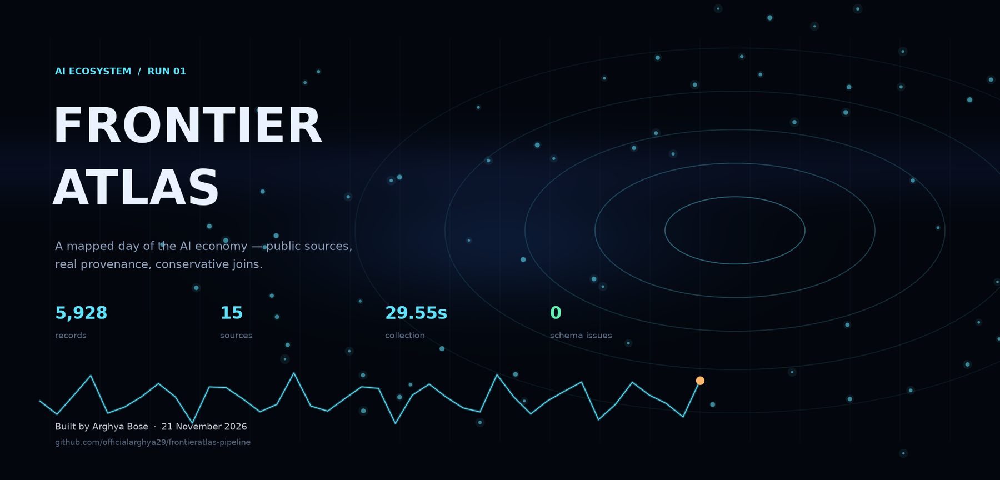
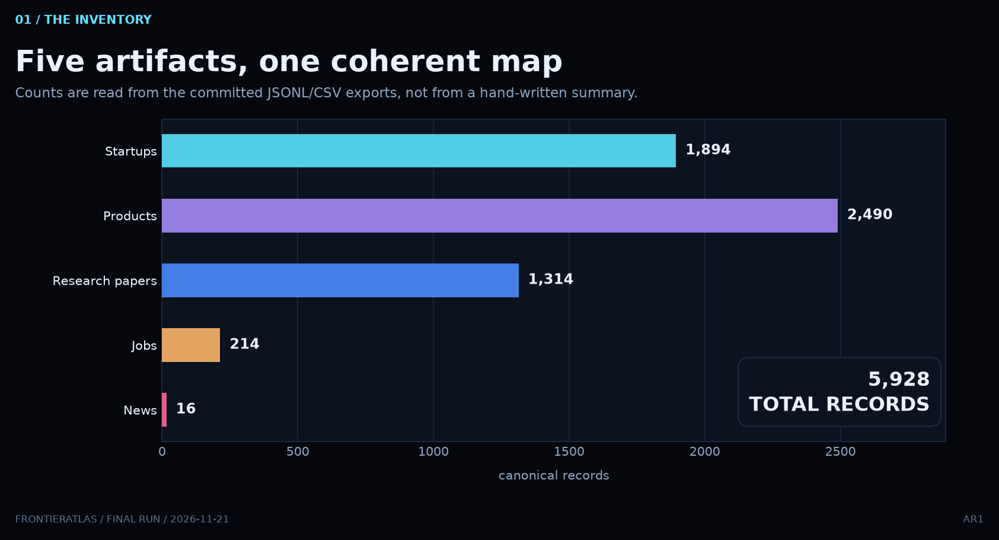
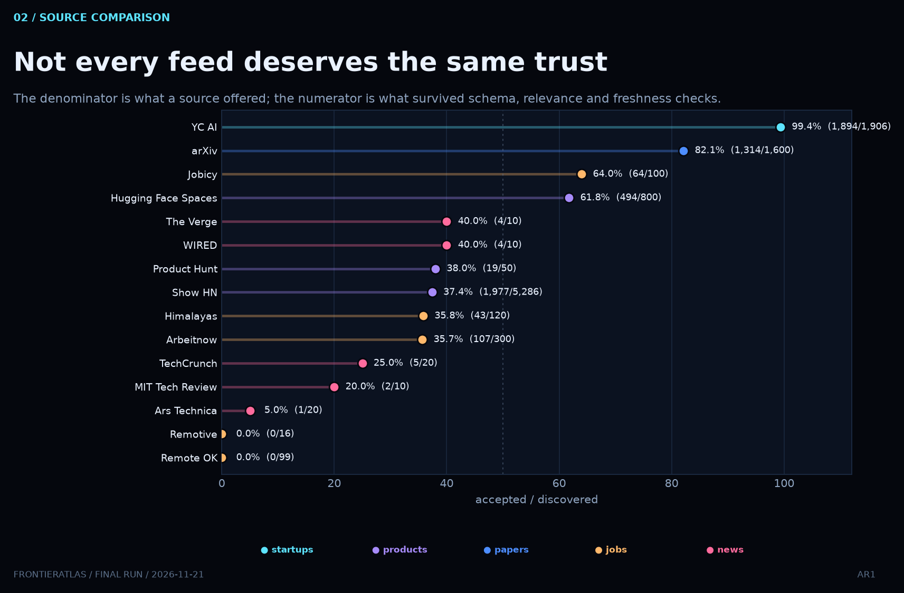
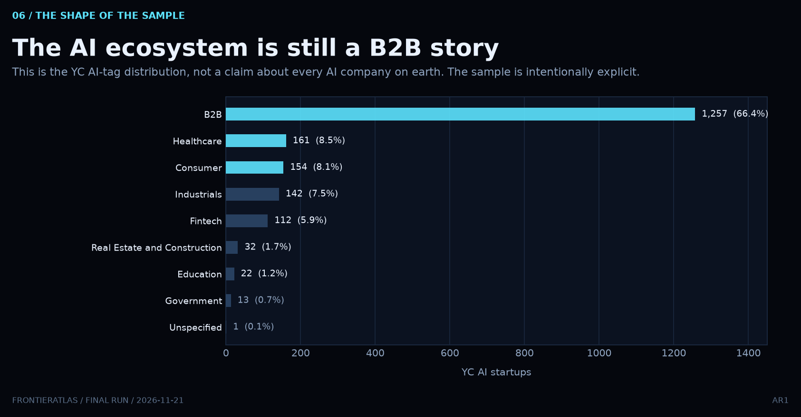
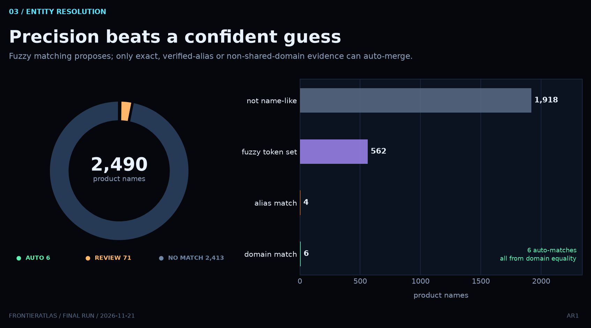
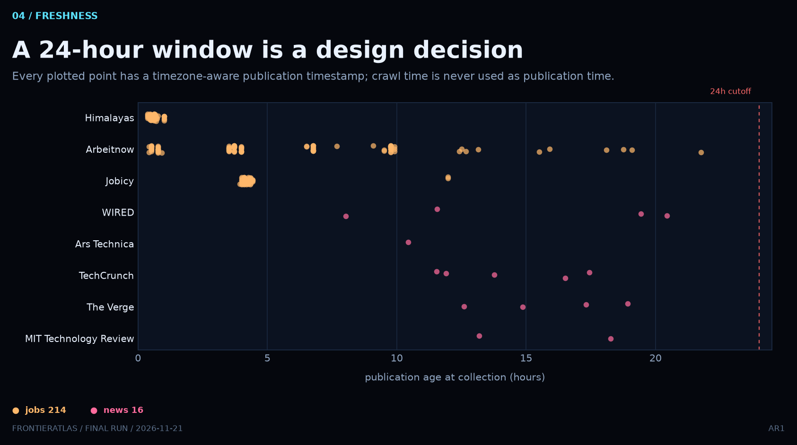
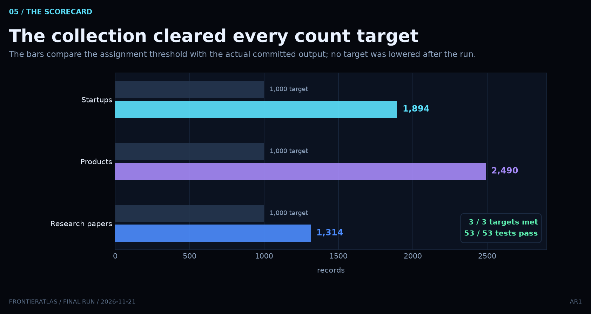
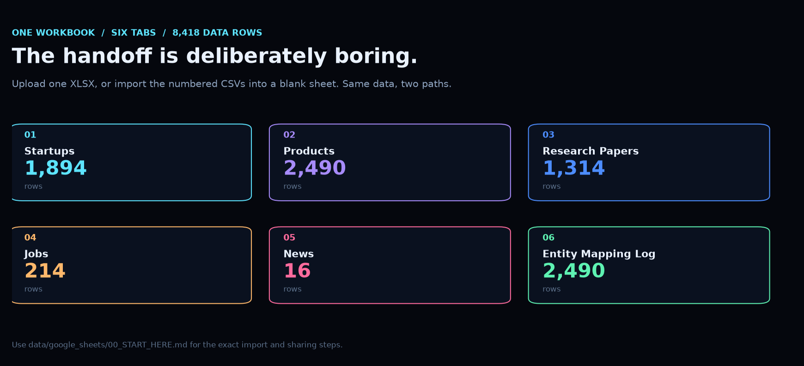
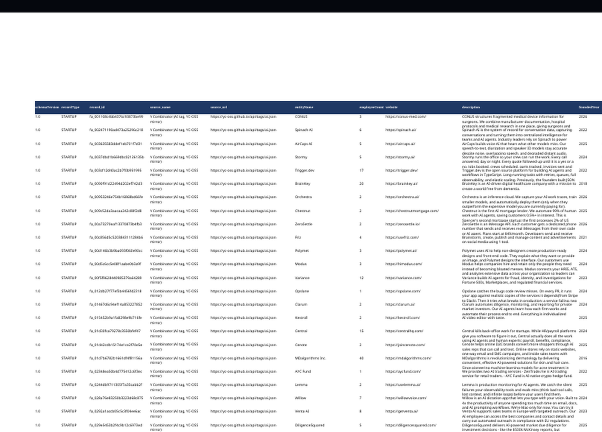
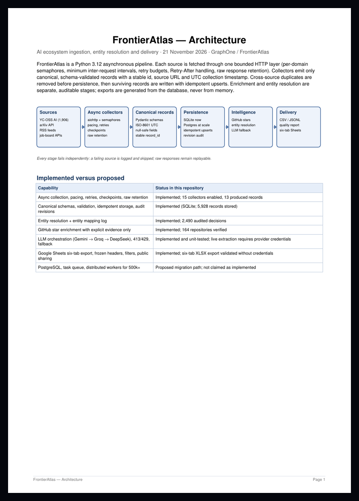

<p align="center">
  
</p>

# FrontierAtlas

**A verifiable map of one day in the AI economy.**

Built by **Arghya Bose** · 21 November 2026 · [Repository](https://github.com/officialarghya29/frontieratlas-pipeline) · [Architecture PDF](architecture.pdf) · [Submission packet](SUBMISSION.md)

> I built FrontierAtlas to answer one question: how much of the AI ecosystem can you collect from public sources without inventing the missing pieces? The final run returned **5,928 records** across five artifact types, plus **2,490 explicit product-to-startup decisions**. Every chart below is generated from the committed exports, not a slide deck.

## At a glance

| Artifact | Records | What it represents |
| --- | ---: | --- |
| Startups | **1,894** | Unique YC AI-tag companies, with website, description, industry and headquarters where published |
| Products | **2,490** | AI launches from Show HN, Hugging Face Spaces and Product Hunt |
| Research papers | **1,314** | Unique arXiv papers across cs.AI, cs.LG, cs.CL, cs.CV and cs.RO |
| Jobs | **214** | Listings with timezone-aware publication timestamps inside a strict 24-hour window |
| News | **16** | AI articles inside the same 24-hour window |
| Entity mapping log | **2,490** | Every product-to-startup decision, including the ones I refused to make |

**5,928 canonical records** · **15 enabled sources** · **29.55-second collection run** · **53 passing tests** · **14/14 preflight checks**

<p align="center">
  
</p>

The Google Sheet is not published yet. I do not have Google credentials on this machine, so I did the next best thing: I made the handoff impossible to confuse. Everything you need is in [`data/google_sheets/`](data/google_sheets/), with one XLSX and six numbered CSVs. The details are in [The Sheet handoff](#the-sheet-handoff).

## The run

The collection started at `2026-11-21T07:25:42Z` and finished at `2026-11-21T07:26:11Z`: **29.55 seconds** for the live run. The longer part was not fetching. It was deciding what deserved to survive.

Every source is treated as a candidate generator, not as truth.

| Gate | What it protects |
| --- | --- |
| Schema validation | No record enters the database without the required fields and types |
| 24-hour freshness | Jobs and news must carry a timezone-aware publication timestamp inside the window; crawl time never counts |
| Source relevance | A launch title has to look like an AI product, not just appear in an AI feed |
| Duplicate handling | Stable IDs and source-level dedupe prevent the same record from inflating the count |
| Provenance | Every record keeps a source URL and a record URL |

This is why the pipeline can say **zero fabricated records** without sounding mysterious. The rules are visible, and the failures are logged.

> **Field note 01 — a feed is a candidate generator, not a dataset.**
>
> The 15 source counters show **10,347 raw candidates** against **5,928 accepted records**. The difference is not a bug; it is the work. Some candidates were stale, some were duplicates, some had no usable URL, and some simply were not about AI. The accepted set is smaller and more useful because the gates are explicit.

## Source yield

<p align="center">
  
</p>

A source's yield is a property of the source, not a measure of how hard the collector worked. YC's AI JSON is clean and nearly complete. arXiv returns duplicate versions of the same paper. News feeds age out quickly. Remotive's timestamps have no timezone, so I could not verify them against a 24-hour cutoff; Remote OK's listings were already older than the cutoff.

| Source | Type | Discovered | Accepted | Yield | What happened |
| --- | --- | ---: | ---: | ---: | --- |
| YC-OSS AI tag | Startups | 1,906 | **1,894** | 99.4% | 12 duplicate company names removed |
| arXiv | Papers | 1,600 | **1,314** | 82.1% | 286 duplicate paper versions removed |
| Jobicy | Jobs | 100 | **64** | 64.0% | Relevant roles with timezone-aware dates |
| Hugging Face Spaces | Products | 800 | **494** | 61.8% | 306 spaces had no usable description |
| The Verge | News | 10 | **4** | 40.0% | 6 older than 24 hours |
| WIRED | News | 10 | **4** | 40.0% | 6 older than 24 hours |
| Product Hunt | Products | 50 | **19** | 38.0% | 31 not AI-relevant |
| Show HN | Products | 5,286 | **1,977** | 37.4% | Relevance, duplicate and missing-URL filters |
| Himalayas | Jobs | 120 | **43** | 35.8% | 77 not AI-relevant |
| Arbeitnow | Jobs | 300 | **107** | 35.7% | Relevance plus 19 stale listings |
| TechCrunch | News | 20 | **5** | 25.0% | 15 stale |
| MIT Technology Review | News | 10 | **2** | 20.0% | 8 stale |
| Ars Technica | News | 20 | **1** | 5.0% | 19 stale |
| Remotive | Jobs | 16 | **0** | 0.0% | Naive publication dates; not 24h-verifiable |
| Remote OK | Jobs | 99 | **0** | 0.0% | All listings older than 24 hours |
| **All sources** | — | **10,347** | **5,928** | **57.3%** | Accepted canonical records |

The two zeroes are deliberate. I did not relax the freshness rule to make a source look productive.

## What the sample looks like

<p align="center">
  
</p>

The YC slice is overwhelmingly B2B: **1,257 of 1,894 companies (66.4%)**. Healthcare, consumer, industrials and fintech are the next four categories. San Francisco alone accounts for **1,145 startups**, which says as much about YC's geography as it does about AI.

| Startup slice | Count | Share |
| --- | ---: | ---: |
| B2B | 1,257 | 66.4% |
| Healthcare | 161 | 8.5% |
| Consumer | 154 | 8.1% |
| Industrials | 142 | 7.5% |
| Fintech | 112 | 5.9% |
| Other categories | 68 | 3.6% |
| **Total** | **1,894** | **100%** |

### Products are launches, not companies

The products are intentionally source-shaped. They are not a commercial product database, and I did not pretend otherwise.

| Product source | Records | Share of products |
| --- | ---: | ---: |
| Show HN | 1,977 | 79.4% |
| Hugging Face Spaces | 494 | 19.8% |
| Product Hunt | 19 | 0.8% |
| **Total** | **2,490** | **100%** |

Only **6 products** have a confident startup association. Pricing is `UNKNOWN` for all 2,490 because the source text did not explicitly support a pricing model; I did not infer one from a landing page or a launch tag. Half the product records have no description, and 19.8% have no category. Those gaps are visible in the quality report, not hidden by a fill step.

### Papers and code evidence

The arXiv set contains **1,314 papers**. Only **170** include an explicit repository URL in the paper text. I verified **164** of those repositories; the other six were missing, deleted, or did not match the requested name. Median stars are `0`, the maximum is `38,630`, and the rest remain `null` rather than guessed.

> **Field note 02 — names are soft keys; domains are hard keys.**
>
> Product titles are written for humans: “Browser”, “Studio”, “Omni Video Factory”, “TRELLIS”. Company names are written for the company. The gap between those two languages is where entity resolution gets dangerous.

## The hardest part: names

<p align="center">
  
</p>

The final resolver made **2,490 decisions**:

| Decision | Count | Meaning |
| --- | ---: | --- |
| `AUTO_MATCHED` | **6** | All six came from non-shared **domain equality**, not a name guess |
| `REVIEW_REQUIRED` | **71** | 4 single-token alias candidates and 67 fuzzy candidates; no association written |
| `NO_MATCH` | **2,413** | 1,918 descriptive titles skipped fuzzy matching; 495 fell below the review threshold |

The first version of this resolver was too eager. It auto-merged a few single-token aliases such as **BOOM**, **TRELLIS**, **Ava**, and a Japanese title that normalized to `AI`. Each one looked plausible in isolation and wrong in context. I tightened the rule: single-token aliases are now review-only, shared hosting domains never count as ownership evidence, and fuzzy candidates need both a high token score and a comparable character ratio before they can auto-merge.

That changed the result from “confident but noisy” to **6 high-confidence associations and 71 visible questions**.

I would rather show you the 71 questions than hide them under a join that looks clever.

### The decision log

| Decision | Why I made it | Effect |
| --- | --- | --- |
| Domain equality can auto-merge | A non-shared website domain is stronger evidence than a similar title | 6 auto-matches |
| Single-token aliases stay in review | `BOOM` and `TRELLIS` collide with unrelated products | 4 alias candidates held back |
| Shared hosts never count | Hugging Face, GitHub, Product Hunt and HN host many different companies | Prevents false domain joins |
| Descriptive titles skip fuzzy matching | A sentence is not an entity name | 1,918 titles ruled out safely |
| Seed names are assistance only | Seeds help matching; they are not collected startups | No seed row leaks into exports |

## 24-hour freshness

<p align="center">
  
</p>

Freshness is the easiest rule to fake and one of the easiest to verify. The pipeline requires a timezone-aware publication timestamp, rejects future timestamps beyond a five-minute clock skew, and never substitutes crawl time.

| Freshness check | Result |
| --- | ---: |
| Accepted jobs | **214** |
| Accepted news | **16** |
| Jobs verified inside 24h | **214 / 214** |
| News verified inside 24h | **16 / 16** |
| Stale publication timestamps rejected | **172** |
| Undated or unparseable records rejected | **16** |
| Remote jobs | **114** |
| News with full text | **11 / 16** |

> **Field note 03 — freshness is a decay curve, not a badge.**
>
> A feed can be technically live and still be useless. The 24-hour window is a promise about the data, and the rejected items are part of the evidence. If I submit this on a later date, I should rerun collection; the committed snapshot is dated **2026-11-21**.

## Quality is the audit trail

<p align="center">
  
</p>

The assignment asked for at least 1,000 startups, 1,000 products and 1,000 papers. The final run cleared all three without changing the thresholds after the fact.

| Target | Required | Actual | Result |
| --- | ---: | ---: | --- |
| Startups | 1,000 | **1,894** | 189% of target |
| Products | 1,000 | **2,490** | 249% of target |
| Research papers | 1,000 | **1,314** | 131% of target |

| Verification | Result |
| --- | --- |
| Schema issues | **0** |
| Automated tests | **53 passed, 0 failed, 0 errors** |
| Preflight checks | **13 / 13 passed** |
| Manifest hashes | **12 verified** |
| Workbook | **6 tabs / 8,418 data rows** |
| Architecture PDF | **3 pages** |
| Secret scan | **0 findings** |
| API failures | **0** |
| Cross-source duplicates removed | **0** |
| SQLite size | **15,077,376 bytes** |

### What is missing — and why

Missing fields are not embarrassing if they are measured. This is the actual missing-field table from the run.

| Field | Missing | Missing % | My decision |
| --- | ---: | ---: | --- |
| Product description | 1,246 / 2,490 | 50.04% | Leave null; do not generate copy |
| Product category | 494 / 2,490 | 19.84% | Leave null; source did not provide one |
| Product startup association | 2,484 / 2,490 | 99.76% | Keep conservative; 71 candidates are in review |
| Startup website | 24 / 1,894 | 1.27% | Leave null |
| Startup employee count | 38 / 1,894 | 2.01% | Leave null |
| Paper GitHub URL | 1,144 / 1,314 | 87.06% | Do not guess repositories from titles |
| Paper GitHub stars | 1,150 / 1,314 | 87.52% | No stars without an explicit repo |

> **Field note 04 — missing data is a finding, not a prompt to improvise.**
>
> A dataset becomes less trustworthy when every cell is filled. I left pricing at `UNKNOWN`, descriptions null, star counts null and startup associations absent where the evidence did not support them. That is why the quality report and the mapping log are part of the deliverable.

### Implemented versus proposed

| Capability | Status in this repository |
| --- | --- |
| Async collection, bounded concurrency, retries, checkpoints, raw retention | **Implemented** |
| Canonical schemas, idempotent storage, revision audit | **Implemented** |
| Entity resolution with auditable mapping log | **Implemented — 2,490 decisions** |
| GitHub star enrichment with explicit evidence only | **Implemented — 164 repositories verified** |
| LLM orchestration with Gemini → Groq → DeepSeek fallback | **Implemented and unit-tested; extraction pending a provider key** |
| Six-tab Google Sheets export and public-sharing guard | **Implemented and dry-run validated; no Sheet URL published** |
| PostgreSQL cluster, durable queue, distributed workers, 500k validation | **Proposed migration path — not claimed as built** |
| Manual-review UI and graph/vector projections | **Proposed** |

## The Sheet handoff

<p align="center">
  
</p>

I did not put a fake Sheet URL in this repository. What I did instead is make the handoff explicit and boring:

- **One XLSX** for the fastest path: `data/google_sheets/FrontierAtlas_Google_Sheets_Upload.xlsx`
- **Six numbered CSVs** if you prefer to build the tabs yourself
- **One start-here guide**: [`data/google_sheets/00_START_HERE.md`](data/google_sheets/00_START_HERE.md)

| Handoff file | Tab | Rows |
| --- | --- | ---: |
| `FrontierAtlas_Google_Sheets_Upload.xlsx` | all six tabs | 8,418 |
| `01_Startups.csv` | Startups | 1,894 |
| `02_Products.csv` | Products | 2,490 |
| `03_Research_Papers.csv` | Research Papers | 1,314 |
| `04_Jobs.csv` | Jobs | 214 |
| `05_News.csv` | News | 16 |
| `06_Entity_Mapping_Log.csv` | Entity Mapping Log | 2,490 |

### If you only do one thing

1. Download `data/google_sheets/FrontierAtlas_Google_Sheets_Upload.xlsx`.
2. Upload it to Google Drive and open it with Google Sheets.
3. Rename it **FrontierAtlas — AI Ecosystem Dataset**.
4. Share it as **Anyone with the link → Viewer**.
5. Open the copied link in an incognito window and confirm all six tabs load.

**Replace any earlier upload.** The corrected workbook has **6 auto-matched / 71 review-required / 2,413 no-match** decisions. Do not leave an older copy public.

The full workbook is 2.5 MB and 8,418 data rows. If you want to inspect the first rows without opening Excel, the crop below is from the actual Startups tab.

<p align="center">
  
  <br>
  <em>Actual workbook crop — the full page is available at <a href="assets/readme/09_workbook_full_page.png">09_workbook_full_page.png</a>.</em>
</p>

The formal architecture artifact is the three-page [architecture.pdf](architecture.pdf). Page 1 is rendered below; the PDF is the version to submit.

<p align="center">
  
</p>

## Reproduce it

```bash
git clone https://github.com/officialarghya29/frontieratlas-pipeline.git
cd frontieratlas-pipeline
python3 -m venv .venv
source .venv/bin/activate
pip install -r requirements.txt
pip install -e . --no-deps

python scripts/collect_all.py
python scripts/enrich_github.py --limit 400
python scripts/resolve_entities.py
python scripts/extract_llm.py --limit 25
python scripts/export_all.py
python scripts/validate_all.py
python scripts/build_submission_workbook.py
pytest
python scripts/build_architecture_pdf.py
python scripts/verify_submission.py
```

The optional visual rebuild is separate:

```bash
pip install -r requirements-dev.txt
python scripts/build_readme_assets.py
python scripts/build_sheet_imports.py
```

The chart generator reads `data/exports/*.csv` and `data_quality_report.json`; the workbook and architecture previews use `libreoffice` and `pdftoppm` if they are installed. The full asset index is in [`assets/readme/ASSET_INDEX.md`](assets/readme/ASSET_INDEX.md).

### The folder map

| Path | What belongs there |
| --- | --- |
| `assets/readme/` | Every README visual, with numbered names and an asset index |
| `data/exports/` | Canonical CSV/JSONL exports, manifest, quality report and workbook |
| `data/google_sheets/` | One XLSX, six numbered CSVs and the start-here guide |
| `src/frontieratlas/` | Collectors, schemas, storage, resolvers, enrichers, exporters |
| `scripts/` | Collection, resolution, export, workbook, PDF, preflight and asset builders |
| `tests/unit/` | 53 mocked-HTTP tests |
| `SUBMISSION.md` | Copy-paste submission packet and the exact Sheet steps |

## Five small theories from this run

1. **A public feed is a candidate generator.** Ten thousand raw candidates is not ten thousand records. The gates are the product.
2. **Names are soft keys; domains are hard keys.** The only six auto-associations came from domain equality. The name-only matches stayed in review.
3. **Freshness is a decay curve.** A feed can be live and still be stale. The 24-hour rule rejected 172 items and left 230 accepted job/news records.
4. **Dedupe early is cheaper than dedupe often.** Source-level duplicate removal kept the database clean before export; the final cross-source duplicate count was zero.
5. **Missing data is information.** Half the products have no description and almost none have a confident startup association. Those gaps are the honest shape of the sources.

## What I would build next

- A small review screen for the 71 entity candidates, with the source URL, candidate domain and evidence note beside each decision.
- A production PostgreSQL path with a durable queue and source-partitioned workers, validated at 500k records rather than claimed.
- Evidence-backed LLM extraction once a provider key is available, with the same “no evidence, no update” rule.
- Richer product descriptions, but only from sources that actually publish them.

## Provenance

The data belongs to its publishers: Y Combinator (via the YC-OSS mirror), arXiv, Product Hunt, Hacker News (Algolia), Hugging Face, TechCrunch, The Verge, WIRED, Ars Technica, MIT Technology Review, Himalayas, Remotive, Remote OK, Arbeitnow, Jobicy and GitHub. Every record keeps its source URL and provenance URL. The source terms and date semantics live in [`config/sources.yaml`](config/sources.yaml).

The repository is authored and maintained by **Arghya Bose** (`officialarghya29@gmail.com`). The submission packet is in [`SUBMISSION.md`](SUBMISSION.md).

<p align="center">
  <sub>FrontierAtlas / AR1 / built to be checked.</sub>
</p>
